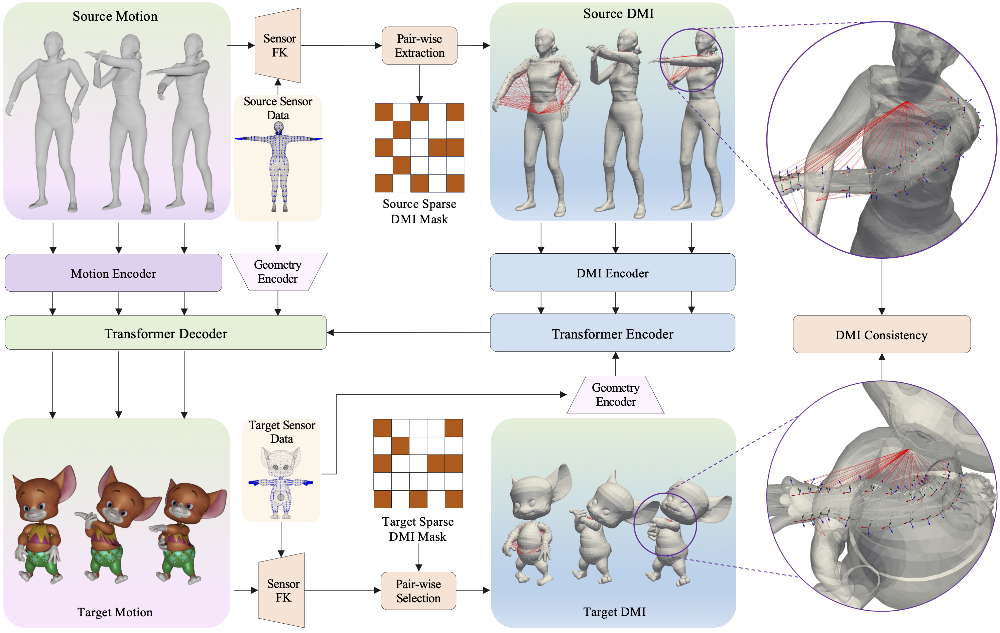

# MeshRet
Official implementation for the NeurIPS 2024 spotlight paper **"Skinned Motion Retargeting with Dense Geometric Interaction Perception"**.

[Project Page](https://abcyzj.github.io/MeshRet/)



## Bibtex

```bibtex
@article{ye2024skinned,
  title={Skinned Motion Retargeting with Dense Geometric Interaction Perception},
  author={Ye, Zijie and Liu, Jia-Wei and Jia, Jia and Sun, Shikun and Shou, Mike Zheng},
  journal={Advances in Neural Information Processing Systems},
  year={2024}
}
```

## Environment

The code was tested on Python 3.10, PyTorch 2.2.0, CUDA 12.1.

### 1. Create conda environment
```bash
conda create -n MeshRet python=3.10 
conda activate MeshRet
```

### 2. Install dependencies

- Install dependencies in `requirements.txt`.

```bash
pip install -r requirements
```

- Install PyTorch3D, please follow the official [instruction](https://github.com/facebookresearch/pytorch3d/blob/main/INSTALL.md) of PyTorch3D. You may need to change the prebuilt wheel according to your CUDA version.

```bash
pip install --no-index --no-cache-dir pytorch3d -f https://dl.fbaipublicfiles.com/pytorch3d/packaging/wheels/py310_cu121
_pyt210/download.html
```

- Install Blender >= 2.82 from: https://www.blender.org/download/.

## Dataset

You can download our preprocessed data from [Google Drive](https://drive.google.com/file/d/1-QbrNePyy0OLZ0K5E5gnIqLH2FOYYssu/view?usp=sharing). After downloading, unzip the compressed file in the current directory.

Alternatively, if you wish to use your own dataset, please follow the instructions below:

- Place the T-pose FBX file and motion FBX files in a directory structured as shown below.

**Note**: Please ensure that each character shares the same skeleton structure as the Mixamo characters.

```bash
costumized_dataset/
│
├─ character1/
│  ├─ character1.fbx # T-pose fbx with mesh
│  ├─ run.fbx # motion fbx
│  └─ pick.fbx # motion fbx
│
├─ character2/
│  ├─ character2.fbx # T-pose fbx with mesh
│  ├─ up.fbx # motion fbx
└─ └─ down.fbx # motion fbx
```

- Execute the following command. The preprocessed data will be saved in the `artifact/costumized_data` directory:

```bash
python -m run.preprocess_fbx --input_dir PATH/TO/FBX --output_dir artifact/costumized_data/
python -m run.motion2points --data_dir artifact/costumized_data/
```

- Specify the unseen characters (`uc`) and unseen motions (`um`) during training in the `artifact/costumized_data/split.json` file. Use the following format as an example:

```json
{
    "uc": [
        "QY_0715_BianYuan_063", 
        "QY_0413_JiangRuiSen_007", 
        "QY_0713_ZhaoXiYan_047", 
        "QY_0801_WeiChunLing_087", 
        "QY_0630_ZouTao_031", 
        "QY_0630_ZhengHaiFei_033", 
        "QY_0801_LiuJun_085", 
        "QY_0630_WuJie_030", 
        "QY_0701_XiaDian_037", 
        "QY_0630_LIXuYe_025"
    ],
    "um": [57, 29, 63, 8, 39, 10, 41, 64, 19]
}
```

## Motion retargeting with pretrained model

You can download the pretrained model from [Google Drive](https://drive.google.com/file/d/1hETgVFnXd8dFag5aKlBdRLC5n4_aHv86/view?usp=sharing). After downloading, unzip the compressed file in the current directory.

### Demo

```bash
python -m run.demo --config artifact/mixamo_all_ret/lightning_logs/version_0/config.yaml --ckpt_path artifact/mixamo_all_ret/lightning_logs/version_0/checkpoints/epoch=36-step=182743.ckpt --output_dir retarget_demo/ --data.seq_len 60
```

### Metrics

Use the following command to compute metrics. Make sure to specify the data split using the `data.split` parameter.

```bash
python -m run.train_retnet test --config artifact/mixamo_all_ret/lightning_logs/version_0/config.yaml --ckpt_path artifact/mixamo_all_ret/lightning_logs/version_0/checkpoints/epoch=36-step=182743.ckpt --data.split uc+um --data.sample_stride 30 # Contact error

python -m run.train_retnet test --config artifact/mixamo_all_ret/lightning_logs/version_0/config.yaml --ckpt_path artifact/mixamo_all_ret/lightning_logs/version_0/checkpoints/epoch=36-step=182743.ckpt --data.split uc+um --data.sample_stride 30 --model.test_penetration true # Penetration ratio 

python -m run.train_retnet test --config artifact/mixamo_all_ret/lightning_logs/version_0/config.yaml --ckpt_path artifact/mixamo_all_ret/lightning_logs/version_0/checkpoints/epoch=36-step=182743.ckpt --data.split uc+um --trainer.devices [6] --data.sample_stride 30 --data.paired_gt true --data.data_dir artifact/datasets/scanret/ # MSE
```

## Train from scratch

After downloading and unzipping the dataset, use the following command to train the model from scratch:

```bash
python -m run.train_retnet fit --config meshret_config.yaml
```

## Acknowledgements

The BVH parser and the Animation object are based on [SAN](https://github.com/DeepMotionEditing/deep-motion-editing) repository.

## License

This code is distributed under an [MIT LICENSE](LICENSE).
